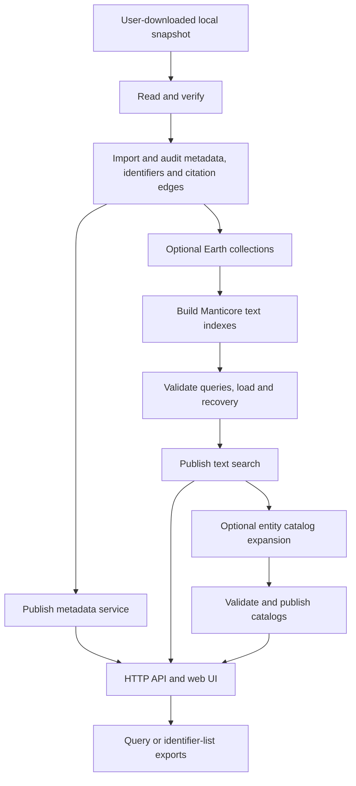

# Architecture and concepts

[中文](ARCHITECTURE.zh-CN.md) · [Documentation](INDEX.md)

OpenAlex Local has two responsibilities: preserve and serve imported OpenAlex
records, and optionally accelerate searches over a chosen subset. Metadata is
the source of record; a text index is a derived retrieval layer.

## Concepts used throughout the guides

| Term | Meaning |
| --- | --- |
| Snapshot / source snapshot | A user-downloaded release of entity records and manifests; read in place, without modifying it |
| Manifest | A machine-readable inventory of files/counts and their identity; not the data files themselves |
| Workspace | Private configuration, persistent databases, task state, engines and outputs for one installation; separate from source code |
| Generation | An imported dataset bound to a particular input identity; a new snapshot requires a new generation |
| Profile | A processing path: default `metadata`, or the optional `earth_sciences` example |
| Collection | A versioned selection of works with inclusion evidence, used for export or indexing |
| Projection | Derived fields suitable for retrieval; it does not replace the original JSON |
| Search build | One version of search artifacts within a generation, with manifests, segment dependencies and validation state |
| Segment | A part of an index that can be sealed and reused; a newer build may depend on older segments |
| Catalog | A name/identity index for entities such as authors, institutions, sources and topics; distinct from a work index |
| Checkpoint / receipt | Durable progress and verification evidence used to resume work safely; completion is not publication |
| Validation / qualification | Checks of data, queries, performance and recovery for the stated scope |
| Publication | Explicitly making qualified metadata/search versions active for service queries |

An authorship is one author-and-affiliation entry in a paper. Matching an author
and institution in the same authorship is stricter than matching both somewhere
in the paper. The supported route contracts explain which rule applies.

## Processing paths

`pipeline plan/run/resume/status` coordinates the metadata path and optional
Earth path. The metadata profile uses `metadata → published`; the Earth profile
adds `collections → index → validated` before publication. Individual modules can
reuse an existing metadata generation. Catalog expansion and query exports have
separate entrypoints and do not run implicitly as pipeline stages.

## Module responsibilities and boundaries

| Module | Inputs | Durable result / consumer |
| --- | --- | --- |
| Local reader and verification | Snapshot path and manifests | Inventory and input checks for import |
| Metadata/citation import | Verified records | Complete source JSON, identifier mappings and forward/reverse citation edges in ClickHouse |
| Optional collection processing | Imported metadata and explicit rules | Versioned work lists with inclusion evidence |
| Text-index construction | Collections and a fixed projection | Manticore segments, snapshots and receipts |
| Catalog expansion | Frozen works plus imported entity metadata | Institution/linked-author catalogs and identity-to-work candidate mappings |
| Validation and publication | Frozen generation/build and query fixtures | Qualification reports and active pointers |
| Query service and UI | Active metadata/search versions | Authenticated HTTP queries and browser workflows |
| Export worker | Pinned query or identifier list | Resumable files and shard receipts, independent of API process lifetime |

The default metadata path needs ClickHouse. Optional text retrieval needs
Manticore. Only the Earth text profile is supplied in this release; generic
all-discipline/profile configuration remains future work. Official classification
models are unnecessary for reading the labels already present in a snapshot.

## Deployment and persistence

The maintained package serves both internal installations and community users.
Code, rules and UI resources ship together; local paths, keys, resource settings,
input snapshots and published data belong to each workspace.

Only one owner holds workspace writers; remote clients use HTTP. Never open the
same ClickHouse data directory with two database processes. A new software
package can reuse compatible indexes: deployment does not inherently require
reindexing. Preserve parent segments, derived identity tables and export-pinned
versions when moving or cleaning a workspace.

Original fields remain accessible through imported metadata even when they are
not indexed filters. DOI/ID lookup and reference-target expansion can resolve
out-of-scope works; their titles are searchable only if included in a published
text index. Missing source abstracts or references are not repaired by rebuilding
an index. See [query coverage](API-COVERAGE.md).

Historical `baseline/` and OpenSearch/Lucene recovery modules remain compatibility
code. The supported search workflow uses Manticore. No external knowledge-graph
project or upstream production orchestration stack is required.

For commands, see [deployment](QUICKSTART.md), [search/exports](SEARCH-EXPORT.md)
and [operations](RELEASE.md). Developers can start with [contributing](../CONTRIBUTING.md).
