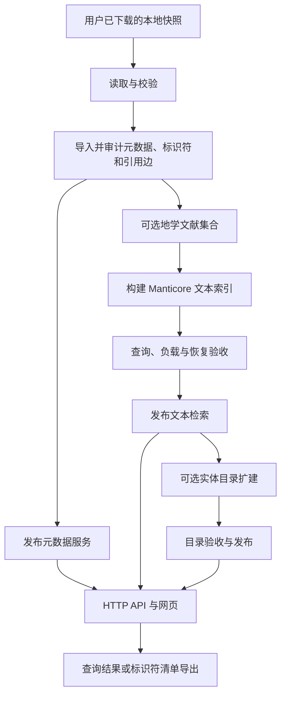

# 架构与核心概念

[English](ARCHITECTURE.md) · [文档导航](INDEX.zh-CN.md)

OpenAlex Local 的职责包括完整保存并提供 OpenAlex 记录，以及按需要为选定文献范围建立高效检索。
元数据是记录依据；文本索引是由元数据派生的检索加速层。

## 文档中的核心术语

| 术语 | 含义 |
| --- | --- |
| Snapshot／源快照 | 使用者下载的某一版实体记录及 manifest；项目从原路径读取，不修改源文件 |
| Manifest／清单 | 描述文件、数量及数据身份的机器可读清单；它本身不包含全部记录 |
| Workspace／工作区 | 一次部署的私有配置、持久数据库、任务状态、引擎和输出；与源码目录分开 |
| Generation／数据代 | 绑定特定输入身份的一份导入数据；更换快照需建立新的 generation |
| Profile／处理方案 | 选择执行路径：默认 `metadata`，可选示例 `earth_sciences` |
| Collection／文献集合 | 按固定规则选择并保留入选证据的版本化文献清单，用于导出或索引 |
| Projection／字段投影 | 从源记录派生适合检索的字段；不替代原始 JSON |
| Search build／索引构建版本 | 某个 generation 下的一版检索产物，包含清单、分段依赖和验证状态 |
| Segment／索引分段 | 可封存和复用的部分索引；新 build 可能依赖旧分段 |
| Catalog／实体目录 | 作者、机构、来源、Topic 等实体的名称与身份索引，与论文索引分开 |
| Checkpoint／检查点、receipt／回执 | 持久进度与校验依据，用于安全恢复；任务完成不代表已发布 |
| Validation／验证、qualification／验收 | 对注明范围的数据、查询、性能和恢复进行检查 |
| Publication／发布 | 显式将符合要求的元数据或索引版本切换为服务当前使用的版本 |

Authorship 指论文中某位作者及其机构的一条署名。要求作者和机构出现在同一条署名中，
比要求二者分别出现在同一篇论文中更严格；具体条件取决于所用接口契约。

## 处理链路

`pipeline plan/run/resume/status` 编排默认元数据路径和可选地学路径。
默认路径为 `metadata → published`；地学路径在发布前加入 `collections → index → validated`。
各模块也可以单独调用并复用已有元数据。实体目录扩建和查询导出有独立入口，不会作为 pipeline 的隐含步骤自动执行。

## 模块职责与边界

| 模块 | 输入 | 持久产物／使用方 |
| --- | --- | --- |
| 本地读取与校验 | 快照路径和 manifest | 数据清点及导入前的输入检查 |
| 元数据与引用导入 | 已校验记录 | ClickHouse 中的完整源 JSON、标识符映射、正反向引用边 |
| 可选文献集合处理 | 导入元数据与显式规则 | 含入选证据的版本化文献清单 |
| 文本索引构建 | 文献集合与固定投影 | Manticore 分段、快照和回执 |
| 实体目录扩建 | 冻结论文集合与导入的实体元数据 | 机构／关联作者目录及身份到论文的候选映射 |
| 验收与发布 | 冻结的数据代／索引版本与查询样例 | 验收报告及生效指针 |
| 查询服务与网页 | 当前生效的元数据／索引版本 | 带认证的 HTTP 查询和网页操作 |
| 导出 worker | 固定版本的查询或标识符清单 | 可恢复的输出文件与分块回执，不依赖 API 进程持续运行 |

默认元数据路径使用 ClickHouse；可选文本检索使用 Manticore。
当前仅提供地学文本 profile，通用全学科或任意范围配置仍待开发。
直接读取快照已有标签无需运行官方分类模型。

## 部署与持久化

内部部署与社区用户使用同一维护包，源码、规则和网页资源一同发布；
路径、密钥、资源参数、输入快照与当前数据版本由各自 workspace 管理。

同一 workspace 的 writer 由唯一 owner 持有，远程客户端通过 HTTP 访问。
不能让两个数据库进程同时打开同一 ClickHouse 数据目录。
兼容的软件更新可以复用已建索引，部署不必然要求重建。
迁移或清理时应保留父分段、身份派生表，以及仍被导出任务固定引用的版本。

原始字段即使没有建立过滤索引，也仍可通过已导入元数据读取。
DOI／ID 和引用目标详情可解析文本范围外的论文；只有进入已发布文本索引的标题才能进行文本搜索。
重建索引不能恢复源数据缺失的摘要和参考文献。详见[查询覆盖](API-COVERAGE.zh-CN.md)。

历史 `baseline/` 及 OpenSearch／Lucene 恢复模块属于兼容代码；当前受支持的检索流程使用 Manticore。
主流程不依赖外部知识图谱项目，也不要求部署上游生产编排系统。

命令见[部署](QUICKSTART.zh-CN.md)、[检索与导出](SEARCH-EXPORT.zh-CN.md)和[运维](RELEASE.zh-CN.md)。
开发者可从[贡献指南](../CONTRIBUTING.zh-CN.md)开始。
